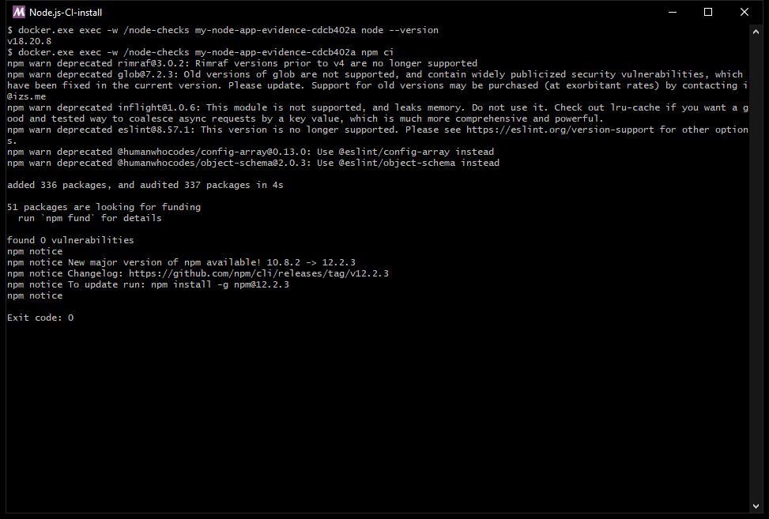
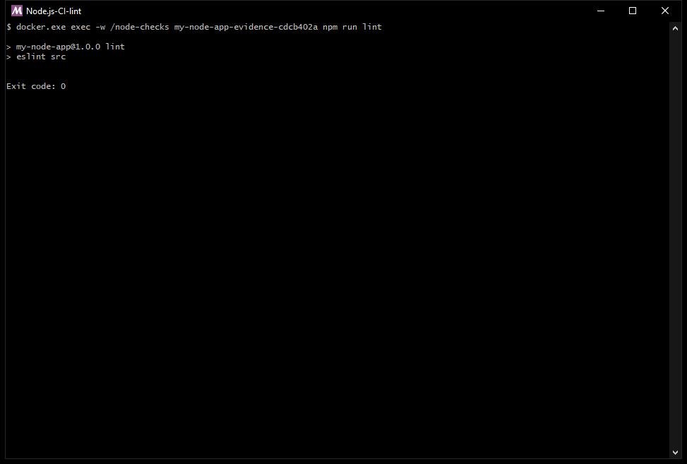
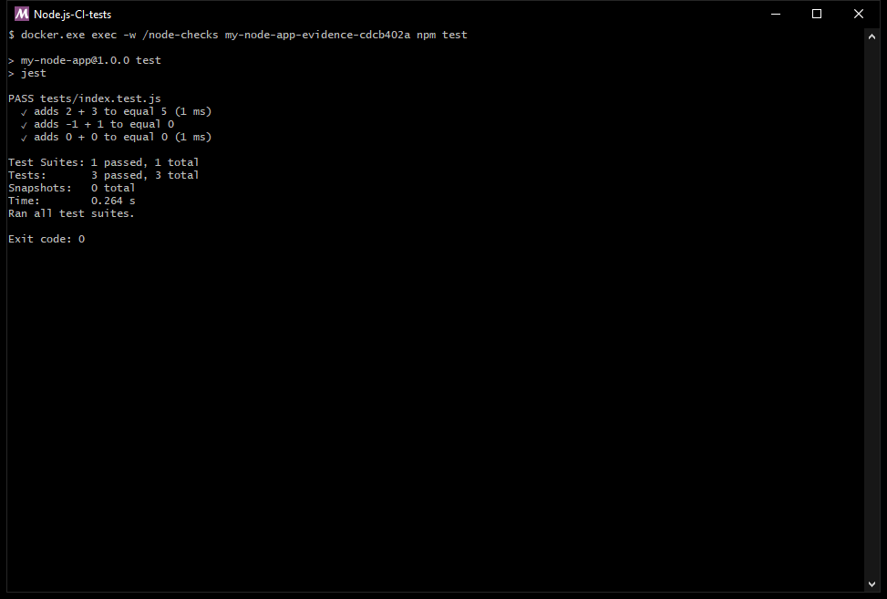
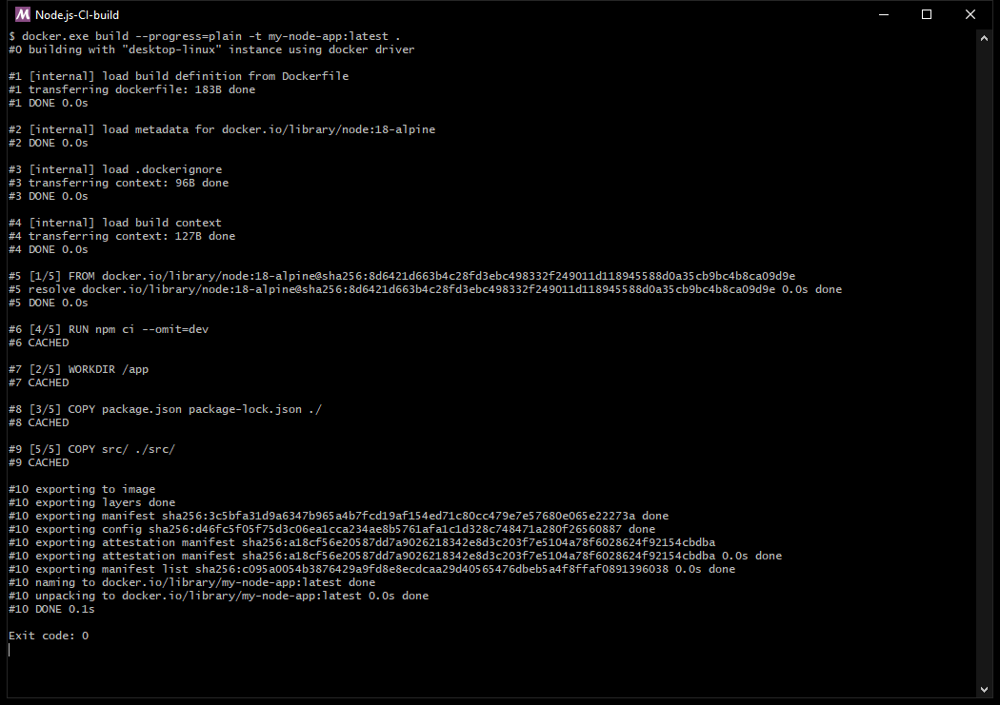
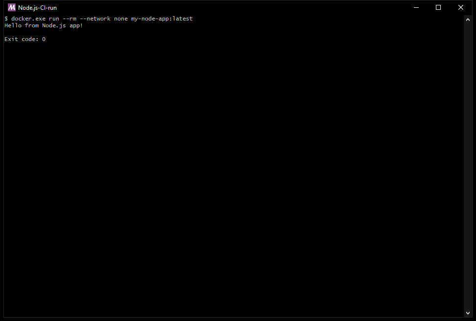

# Pipeline CI на Node.js в GitHub Actions

Цель работы — настроить CI для Node.js-приложения, проверить его на трёх версиях Node.js и собрать Docker-образ. Функция `add(a, b)` возвращает сумму двух чисел. При запуске из командной строки приложение выводит `Hello from Node.js app!`. [Методичка преподавателя](https://github.com/rurewa/imfua/blob/main/content/DevOps/CI_CD/Pipelines/NodeJS.md)

Локальные проверки выполнены. Первый запуск GitHub Actions запланирован после публикации проекта.

## Структура проекта

| Путь | Назначение |
| --- | --- |
| `.github/workflows/ci.yml` | Матрица Node.js, линтинг, тесты, сборка и сохранение образа. |
| `src/index.js` | Функция `add` и запуск приложения. |
| `tests/index.test.js` | Три теста Jest для `2 + 3`, `-1 + 1` и `0 + 0`. |
| `package.json`, `package-lock.json` | Скрипты и точные версии зависимостей для `npm ci`. |
| `.eslintrc.json` | Правила ESLint из методички. |
| `Dockerfile`, `.dockerignore` | Сборка на официальном `node:18-alpine` и состав контекста. |
| `.gitignore` | Исключения для зависимостей, отчётов, файлов окружения и локальных архивов. |
| `screenshots/` | Настоящие снимки локальных проверок. |

## Как работает CI

Workflow реагирует на push в `main` или `master` и на pull request с целью в одну из этих веток. Задание **Lint & Test** запускает `npm ci`, `npm run lint` и `npm test` на Node.js **18.x, 20.x и 22.x**. Кэш npm привязан к `package-lock.json`. Node.js 18 и 20 оставлены в матрице по методичке, обе ветки завершили цикл поддержки. [Манифест сборок для GitHub Actions](https://github.com/actions/node-versions/blob/main/versions-manifest.json) · [Статусы версий Node.js](https://nodejs.org/en/about/previous-releases)

Задание **Build Docker Image (no push)** запускается после успешной матрицы только при push в `main`. Оно собирает образ `my-node-app:test` и упаковывает его в артефакт запуска `my-node-app-image`, который можно скачать и загрузить через `docker load`. В workflow используются `checkout@v7`, `setup-node@v7` и `upload-artifact@v7`. [Настройка Node.js в Actions](https://github.com/actions/setup-node/tree/v7) · [Артефакты GitHub Actions](https://docs.github.com/en/actions/tutorials/store-and-share-data)

## Установка и проверки в Windows PowerShell

Запустите Docker Desktop в режиме Linux-контейнеров и откройте PowerShell в корне `my-node-app`. При изменении зависимостей обновите lock-файл внутри Docker.

~~~powershell
$source = (Resolve-Path -LiteralPath .).Path
docker run --rm --mount "type=bind,source=$source,target=/app" --workdir /app node:18-alpine npm install --package-lock-only
~~~

Следующие команды запускают ту же матрицу локально. Исходники смонтированы только для чтения, установка идёт во временном контейнере.

~~~powershell
$source = (Resolve-Path -LiteralPath .).Path
$checks = 'set -eu; mkdir /checks; cp -R /source/.eslintrc.json /source/package.json /source/package-lock.json /source/src /source/tests /checks/; cd /checks; node --version; npm ci; npm run lint; npm test'
foreach ($major in 18, 20, 22) {
    docker run --rm --cpus 2 --mount "type=bind,source=$source,target=/source,readonly" ("node:{0}-alpine" -f $major) sh -c $checks
    if ($LASTEXITCODE -ne 0) { throw "Проверка Node.js $major завершилась ошибкой." }
}
~~~

## Сборка и запуск Docker

В Dockerfile указаны оба файла пакета, поскольку `npm ci` требует существующий lock-файл. Вместо устаревшего флага `--only=production` используется `--omit=dev`. В рабочий образ копируются пакетные файлы и `src/`. ESLint и Jest устанавливаются при проверках CI. [Документация npm ci](https://docs.npmjs.com/cli/v10/commands/npm-ci/)

~~~powershell
docker build --progress=plain -t my-node-app:latest .
docker run --rm --network none my-node-app:latest
~~~

Результат запуска — `Hello from Node.js app!`. Контейнер завершает работу с кодом `0`.

## Результаты локальных проверок

| Node.js | npm | `npm ci` | ESLint | Jest |
| --- | --- | --- | --- | --- |
| 18.20.8 | 10.8.2 | Успешно | 0 замечаний | 3 из 3 |
| 20.20.2 | 10.8.2 | Успешно | 0 замечаний | 3 из 3 |
| 22.23.5 | 10.9.9 | Успешно | 0 замечаний | 3 из 3 |

- Lock-файл формата 3 создан в Docker. Он зафиксировал ESLint 8.57.1 и Jest 29.7.0. npm предупредил об устаревании ESLint 8 и некоторых зависимостей разработки. ESLint 8 сохранён для конфигурации `.eslintrc.json` по методичке.
- `npm start` и контейнерный запуск вывели ожидаемое приветствие. Сборка включила lock-файл, ESLint и Jest в рабочем образе отсутствуют.
- `actionlint` 1.7.12 проверил YAML без ошибок. `docker save` создал пробный TAR с тегом `my-node-app:test`.

## Скриншоты

### Установка зависимостей

### ESLint

### Jest

### Docker build

### Docker run

## Первый запуск на GitHub

После согласования публикации поместите содержимое проекта в корень репозитория `my-node-app` вместе с `.github/workflows/ci.yml` и отправьте ветку `main`. На вкладке **Actions** откройте **CI for Node.js App**. Проверьте три варианта **Lint & Test** и результат **Build Docker Image (no push)**.

После успешного запуска скачайте **my-node-app-image** из раздела **Artifacts**, распакуйте ZIP и выполните команды из каталога с TAR.

~~~powershell
docker load -i .\my-node-app.tar
docker run --rm --network none my-node-app:test
~~~
